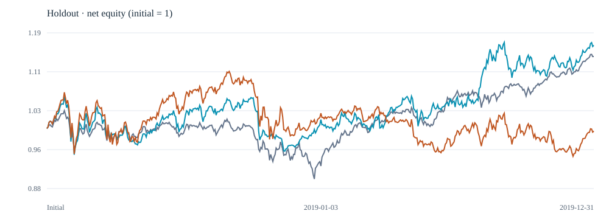

# Quant Research Agent

[English](#english) · [简体中文](#中文)

<a id="english"></a>

## English

An auditable workflow for factor research and out-of-sample evaluation. Given daily closing prices with documented provenance, the Agent proposes a limited set of cross-sectional ranking signals, tests them on development data, freezes the selected code, and scores a sealed holdout once. The project tests whether the research process is trustworthy; it does not establish live trading performance or promise returns. Forked from [QZTnb/research-agent](https://github.com/QZTnb/research-agent), it retains the original experiment tree, budgets, ledger, and capability library. The original system documentation is archived in [legacy-project-readme.md](docs/legacy-project-readme.md).

### Auditable research workflow

1. The dataset manifest declares `source`, `license`, `price_basis`, and the CSV SHA-256. This version accepts a complete, fixed asset universe and rejects missing, duplicate, non-positive, or non-finite prices.
2. Chronological train, development, and sealed holdout windows leave a gap for the label horizon. Signals see history through the close of `t`, trade at the close of `t+1`, and realize returns through `t+2`. Backtests include fees, slippage, turnover, maximum drawdown, and an equal-weight comparison.
3. Each candidate `compute_signal(history)` runs in a macOS `sandbox-exec` subprocess. It receives only the price prefix available on each signal date, with no API key, dataset path, or network access. Scoring requires the sandbox.
4. Every attempt retains its experiment-tree record, source code, development score, and ledger entry, including failures and negative results. Data, all role prompts, budget rules, triggers, and task-visible inputs are hashed and rechecked before the best development node and ledger are frozen.
5. Missing usage, execution errors, or changed inputs produce a failed terminal record and prevent selection. Before scoring, an independent finalizer checks development admission and frozen inputs, then creates an exclusive attempt marker. A scoring attempt cannot be repeated, even after failure.

### Real Qwen experiment: no improvement over the original signal

`qwen3.5-27b` completed one ETF study. All three executed and scored development candidates were rejected, so the frozen selection rule retained `n0000`, the original five-session momentum signal. The selected code was then scored once on 61 common trading sessions from 2020-01-06 to 2020-04-01. Results include fees and slippage:

| Strategy | Period net return | Maximum drawdown |
| --- | ---: | ---: |
| Daily equal weight | −12.47% | 20.96% |
| Original five-session momentum | +6.07% | 6.72% |
| Agent selection: original signal retained | +6.07% | 6.72% |

The selection beat equal weight by **18.54 percentage points**, but its improvement over the original signal was **zero**. The return cannot be attributed to a Qwen-generated improvement. The successful development run recorded **17,791 tokens across six calls**. Four earlier authentication or timeout failures are retained with unknown usage; 17,791 is not the total cost of all attempts, and unknown usage is not zero. This is a single exploratory observation over a short period.

[Results and negative findings](docs/qwen-etf-case/report.md) · [Evidence index](docs/qwen-etf-case/evidence-index.json) · [Protocol and runbook](docs/qwen-etf-comparison.md)

### Historical baseline with fixed rules

Seven fixed candidates were evaluated across three development windows using public historical snapshots for eight ETFs. The selection was 126-session momentum. Its frozen 2018–2019 results, after fees and slippage, were:

| Strategy | Period net return | Maximum drawdown |
| --- | ---: | ---: |
| Daily equal weight | +14.06% | 12.90% |
| Predeclared 63-session momentum | +16.25% | 10.73% |
| Development-selected 126-session momentum | −0.49% | 14.92% |

**The development selection underperformed equal weight by 14.56 percentage points on the holdout.** The failure and all candidate evidence are retained; the winner was not replaced after seeing holdout results. This fixed-rule study made zero model calls and is reported separately from the Qwen experiment.



[Findings and reproduction](docs/etf-case-study/README.md) · [Full report](docs/etf-case-study/report.md) · [Daily JSON evidence](docs/etf-case-study/study.json)

The 2018–2019 period was opened by this baseline study and quarantined from the later Qwen experiment. Qwen used a separately registered 2020-01-06–2020-04-01 interval, whose single sealed evaluation is now complete.

### Reproduce without an API key

#### Real ETF baseline

Research question: **Can simple cross-sectional ETF rankings consistently beat daily equal weight across different years after trading costs?** The study fixes eight ETFs, downloads a public 2008–2019 price snapshot, compares a fixed grid across three 2012–2017 development windows, freezes the selection, and evaluates the 2018–2019 holdout. All candidates and negative results are retained. See the [research protocol](config/etf_case_study.json), committed before performance was calculated.

```bash
python3.11 -m venv .venv
.venv/bin/python -m pip install -e .
.venv/bin/python -m quant_research.etf_case
```

No API key is needed. Network access downloads the fixed dataset version; no model is called. Outputs include `runs/etf-case-*/report/index.html` and `report.md`. JSON evidence retains daily positions, net returns, equity, turnover, and input hashes. Reuse an existing dataset with `--dataset-manifest runs/etf-case-data-v1/manifest.json`; every output directory must be new.

The comparison lines are daily equal weight, predeclared 63-session momentum, and the selected candidate from seven fixed rules, ranked by worst development-window net excess return, then mean net excess return, then candidate ID. Each window starts from cash, includes initial entry costs, and charges 2 bps in fees plus 3 bps in slippage on traded notional. **This is a fixed-rule study with zero model calls, not evidence of Qwen or Agent performance.** The separately registered Qwen experiment uses a different holdout and is reported above.

The data is a Kaggle uploader's Yahoo/yfinance adjusted-price snapshot, with limitations from a fixed surviving ETF universe, retrospective adjustments, and execution assumptions. Market CSVs remain in local, Git-ignored `runs/`; upstream redistribution rights have not been independently verified. The repository publishes download code, provenance hashes, and derived research results. See [data sources and limitations](docs/etf-data-sources.md).

#### Agent workflow on synthetic data

From the repository root on macOS with Python 3.11:

```bash
python3.11 -m venv .venv
.venv/bin/python -m pip install -e .
.venv/bin/python -m quant_research.run --mode scripted
```

The command prints `runs/<run_id>/dev_report.json`. Inspect `selection.json`, `tasks/quant-demo/tree.jsonl`, and `ledger.jsonl` in the same run to see rejected candidates and their scores. This demonstration uses **deterministic synthetic prices and scripted roles, with zero model calls**. Development does not score the sealed holdout. To demonstrate the one-shot finalizer, check the selection and explicitly run:

```bash
.venv/bin/python -m quant_research.finalize_cli \
  --run-dir runs/<run_id> --evaluate-sealed-once
```

`final/report.json` identifies `SYNTHETIC DATA`, `selected_origin`, risks, and trading costs. Synthetic returns or Sharpe ratios are not investment performance.

### Qwen development experiments

`--mode qwen` uses `qwen3.5-27b` at the default gateway `https://ai-gateway.theunifiedcare.com/v1`. Market-data research requires a dataset manifest, all four split dates, and `--protocol`. The protocol must match the dataset manifest and hash, dates, model, costs, and budgets. User-supplied data also requires all four dates in scripted mode; it never silently uses the synthetic demo's split positions. Preview the data type, windows, sample counts, and token budget before making model calls.

The protocol, paths, and dates below illustrate the command format. First prepare a `qwen_etf_comparison_protocol/1` matching your own data and settings. The [ETF runbook](docs/qwen-etf-comparison.md) provides the actual study's full command. Preflight only reads and validates local inputs: **it creates no run, makes no network requests, and requires neither an API key nor a clean checkout**.

```bash
.venv/bin/python -m pip install -e '.[llm]'
quant_data_args=(
  --protocol config/my-market-protocol.json
  --dataset-manifest data/my-market/manifest.json
  --train-end 2018-12-28
  --dev-start 2019-01-04
  --dev-end 2022-12-23
  --holdout-start 2023-01-03
)
.venv/bin/python -m quant_research.run --mode qwen \
  "${quant_data_args[@]}" --preflight-only
```

Before live calls, set `OPENAI_API_KEY` in the current terminal's environment. Keep the key out of command arguments, configuration files, and Git. A live run requires a clean, committed checkout. The default per-task budget is 40,000 tokens, and the run prints its summary before calling the model. Ledger `TOKENS` measure resources; **they are not cash prices**.

```bash
.venv/bin/python -m quant_research.run --mode qwen \
  "${quant_data_args[@]}" --budget-tokens 40000
```

To explicitly permit model usage solely for checking the gateway connection with synthetic demo data:

```bash
.venv/bin/python -m quant_research.run --mode qwen \
  --allow-synthetic-paid-demo --preflight-only
.venv/bin/python -m quant_research.run --mode qwen \
  --allow-synthetic-paid-demo
```

Both data paths retain their source labels; model calls on synthetic data are not market evidence. User-supplied daily closes need a `quant_dataset/1` manifest with a permission statement and SHA-256. This version does not handle delistings, changing constituents, corporate-action verification, actual fills, or market impact, so real-market results remain research demonstrations. See [Quant Research MVP](docs/quant-research-mvp.md) for the full format, method, and limitations.

### Verification

```bash
.venv/bin/python -m unittest tests.test_quant_data tests.test_quant_splits \
  tests.test_quant_backtest tests.test_quant_signals tests.test_quant_harness \
  tests.test_quant_core_compat tests.test_quant_provenance \
  tests.test_quant_run tests.test_quant_finalize \
  tests.test_quant_etf_data tests.test_quant_etf_study \
  tests.test_quant_etf_report tests.test_quant_etf_case -v
```

Scripted roles verify the Agent workflow; the ETF baseline checks fixed rules on historical data. The real Qwen experiment is complete, and none of its three executed candidates beat the original signal. It provides auditable negative evidence, without establishing model improvement, stable returns, or cash savings.

---

<a id="中文"></a>

## 中文｜量化因子研究与样本外验证

一个可审计的研究工作流：给定有来源声明的日收盘价，Agent 提出有限的截面排序信号，在开发期逐一证伪，冻结入选代码后仅对封存期评分一次。目标是检验研究流程是否可信，**不是自动选股、实盘交易或收益承诺**。本项目从 [QZTnb/research-agent](https://github.com/QZTnb/research-agent) 分叉，保留原有实验树、预算、账本与能力库；原系统说明归档在 [legacy-project-readme.md](docs/legacy-project-readme.md)。

### 已实现的闭环

1. 数据清单声明 `source`、`license`、`price_basis` 和 CSV SHA-256。首版只接收完整的固定股票池，拒绝缺失、重复、非正和非有限价格。
2. 训练／开发／封存时间切分留出标签跨度。信号在 `t` 收盘后只见历史，`t+1` 收盘交易，`t+2` 实现收益；回测计手续费、滑点、换手与最大回撤，并与等权比较。
3. 候选 `compute_signal(history)` 在 macOS `sandbox-exec` 子进程执行。子进程逐日只收到截至信号日的价格前缀，没有 API key、数据文件路径或网络权限；无沙箱时拒绝评分。
4. Agent 的每次尝试写入实验树、原始代码、开发期评分和账本；失败与负结果保留。数据、全部角色提示词、预算规则、触发词和任务可见输入均记录哈希，运行结束时复核，再冻结最优开发期节点和账本。
5. 用量缺失、运行错误或输入变更会记录失败终态并禁止生成选择记录。独立 finalizer 在评分前复核开发运行准入条件和冻结输入，再创建排他尝试标记；成功或失败都不能重试同一封存期。

### 真实 Qwen 实验：未找到优于原始信号的候选

`qwen3.5-27b` 已完成一次 ETF 研究：开发期执行并评分的 3 个候选均被拒绝，最终按预先固定的规则保留 `n0000` 原始 5 日动量。冻结选择后，在 2020-01-06—2020-04-01 的 61 个共同交易日上完成唯一一次封存评分，结果已扣除手续费与滑点：

| 策略 | 区间净收益 | 最大回撤 |
| --- | ---: | ---: |
| 每日等权 | −12.47% | 20.96% |
| 原始 5 日动量 | +6.07% | 6.72% |
| Agent 入选方案（保留原始信号） | +6.07% | 6.72% |

入选方案超过等权 **18.54 个百分点**，但相对原始信号的改进为 **0**，不能把这段收益归功于 Qwen。成功开发运行的 6 次调用共记录 **17,791 tokens**；此前 4 次鉴权或超时失败全部保留，用量未知，不能把完整实验成本写成 17,791 或把失败用量算作零。这是单次、短区间的探索性观察。

[结果与负结果](docs/qwen-etf-case/report.md) · [证据索引](docs/qwen-etf-case/evidence-index.json) · [协议与运行手册](docs/qwen-etf-comparison.md)

### 固定规则的历史基线案例

在 8 只 ETF 的公开历史快照上，7 个固定候选经过三个开发窗口选出了 126 日动量。冻结后的 2018—2019 年结果如下，已扣除手续费与滑点：

| 策略 | 区间净收益 | 最大回撤 |
| --- | ---: | ---: |
| 每日等权 | +14.06% | 12.90% |
| 预先固定的 63 日动量 | +16.25% | 10.73% |
| 开发期选出的 126 日动量 | −0.49% | 14.92% |

**开发期选优在封存期落后等权 14.56 个百分点。** 我们保留这次失败与全部候选证据，不根据封存结果重新选赢家。这项固定规则研究的模型调用为零，与上面的 Qwen 实验分别报告。


[案例结论与复现](docs/etf-case-study/README.md) · [完整报告](docs/etf-case-study/report.md) · [逐日 JSON 证据](docs/etf-case-study/study.json)

2018—2019 已被本案例打开，在后续 Qwen 实验中被隔离；Qwen 使用单独注册的 2020-01-06—2020-04-01 区间，现已完成一次封存评分。

### 无密钥复现

#### 真实 ETF 基线案例

研究问题是：**简单的 ETF 截面排序，在不同年份扣除交易成本后，能否稳定超过每日等权？** 固定 8 只 ETF，下载 2008—2019 年的公开历史快照；先在 2012—2017 年的三个开发窗口比较固定网格，再冻结选择并评估 2018—2019 年封存窗口。所有候选和负结果均保留，规则见运行绩效计算前提交的 [研究协议](config/etf_case_study.json)。

```bash
python3.11 -m venv .venv
.venv/bin/python -m pip install -e .
.venv/bin/python -m quant_research.etf_case
```

该命令不需要 API key，只为获取固定版本数据访问公开网络，不调用模型。输出 `runs/etf-case-*/report/index.html` 和 `report.md`；JSON 证据保留逐日持仓、费用后的回报、净值、换手和输入哈希。已有下载可用 `--dataset-manifest runs/etf-case-data-v1/manifest.json` 复用，输出目录必须是新目录。

比较线是每日等权、预先固定的 63 日动量，以及 7 个固定候选中按“最差开发窗口净超额、平均净超额、候选 ID”依次排序的入选方案。每个窗口从现金起步，计入初次建仓成本，单边手续费 2 bps、滑点 3 bps。**这是零模型调用的固定规则研究，不是 Qwen 或 Agent 效果。** 另行注册并完成的 Qwen 实验使用不同封存区间，结果见上方。

数据是 Kaggle 上传者提供的 Yahoo/yfinance 调整价快照，存在固定存续 ETF 池、事后复权和成交假设限制。原行情仅保存在本地被忽略的 `runs/`；上游权利未独立核验，仓库公开下载代码、来源哈希与派生研究结果。见 [数据来源与边界](docs/etf-data-sources.md)。

#### 合成数据的 Agent 闭环演示

在 macOS、Python 3.11 环境从仓库根目录运行：

```bash
python3.11 -m venv .venv
.venv/bin/python -m pip install -e .
.venv/bin/python -m quant_research.run --mode scripted
```

命令会打印 `runs/<run_id>/dev_report.json`。查看同目录的 `selection.json`、`tasks/quant-demo/tree.jsonl` 和 `ledger.jsonl`，确认包括未入选方案及其分数。此演示使用**确定性合成价格和脚本角色，模型调用为零**；开发期报告不会打开封存期。若要演示单次评分，检查选择记录后明确执行：

```bash
.venv/bin/python -m quant_research.finalize_cli \
  --run-dir runs/<run_id> --evaluate-sealed-once
```

`final/report.json` 会注明 `SYNTHETIC DATA`、`selected_origin`、风险与交易成本。不要把合成数据上的百分比或 Sharpe 解读为投资业绩。

### Qwen 开发实验

`--mode qwen` 固定使用 `qwen3.5-27b`，默认网关是 `https://ai-gateway.theunifiedcare.com/v1`。正常研究须显式提供数据清单、全部四个切分日期及 `--protocol`。协议须与本次数据清单及其哈希、日期、模型、费用和预算匹配；自有数据在脚本模式下也需要四个日期，不会自动套用演示数据的位置。先预检数据类型、时间区间、各区间样本数和 token 预算，再启动模型调用。

下面的协议、清单路径和日期是命令格式示例，请先准备与你的数据及参数匹配的 `qwen_etf_comparison_protocol/1` 协议。ETF 实验的完整命令见[运行手册](docs/qwen-etf-comparison.md)。预检只读取和校验本地输入，**不创建运行目录、不联网，也不需要 API key 或干净工作树**。

```bash
.venv/bin/python -m pip install -e '.[llm]'
quant_data_args=(
  --protocol config/my-market-protocol.json
  --dataset-manifest data/my-market/manifest.json
  --train-end 2018-12-28
  --dev-start 2019-01-04
  --dev-end 2022-12-23
  --holdout-start 2023-01-03
)
.venv/bin/python -m quant_research.run --mode qwen \
  "${quant_data_args[@]}" --preflight-only
```

实际调用前，在当前终端通过环境变量提供 `OPENAI_API_KEY`，不要把密钥写进命令行、配置或 Git。真实调用要求工作树已提交且干净；每题默认预算为 40,000 token，启动时会再次显示运行摘要。账本 `TOKENS` 是资源计量，**不是现金价格**。

```bash
.venv/bin/python -m quant_research.run --mode qwen \
  "${quant_data_args[@]}" --budget-tokens 40000
```

仅为检查真实网关与合成演示的接线时，可以明确允许模型消耗：

```bash
.venv/bin/python -m quant_research.run --mode qwen \
  --allow-synthetic-paid-demo --preflight-only
.venv/bin/python -m quant_research.run --mode qwen \
  --allow-synthetic-paid-demo
```

这两种数据路径都会保留来源标签；合成演示调用不构成真实市场实证。自有日收盘价须有带许可和 SHA-256 的 `quant_dataset/1` 清单。首版不处理退市、动态成分股、复权核查、真实成交与市场冲击，所以真实市场数据结果也只能作为研究演示。完整数据格式、方法与限制见 [量化研究 MVP 文档](docs/quant-research-mvp.md)。

### 验证

```bash
.venv/bin/python -m unittest tests.test_quant_data tests.test_quant_splits \
  tests.test_quant_backtest tests.test_quant_signals tests.test_quant_harness \
  tests.test_quant_core_compat tests.test_quant_provenance \
  tests.test_quant_run tests.test_quant_finalize \
  tests.test_quant_etf_data tests.test_quant_etf_study \
  tests.test_quant_etf_report tests.test_quant_etf_case -v
```

脚本角色验证 Agent 工程闭环，ETF 基线案例验证固定规则在历史数据上的表现。真实 Qwen 实验已完成，3 个候选均未超过原始信号；它提供可审计的负结果，不构成模型提升、稳定收益或现金节省的证据。
