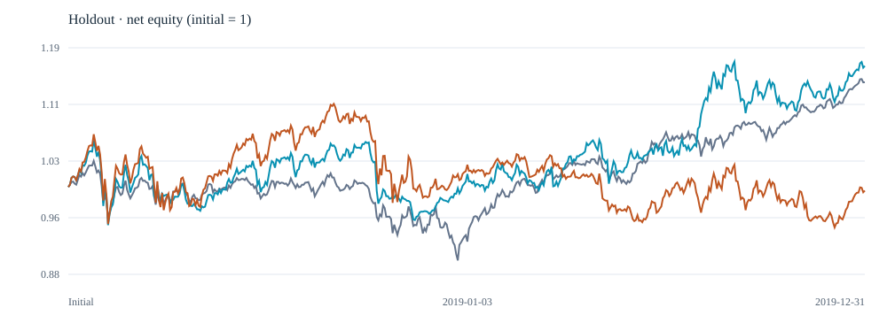
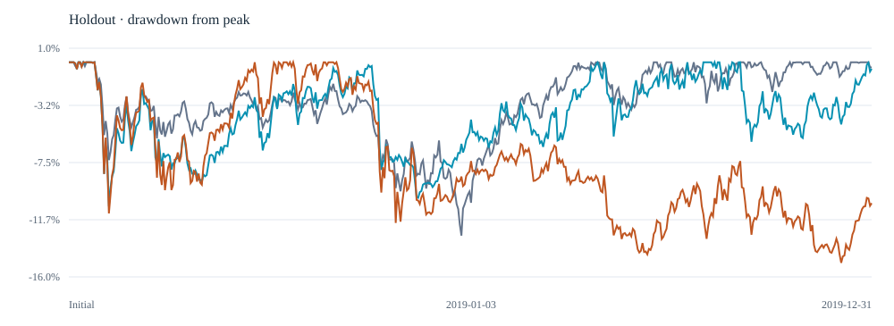

# 真实 ETF 研究案例：开发期选优没有通过样本外验证

这次研究检验固定规则能否在不同年份稳定超过每日等权。**它没有调用 Qwen 或其他模型，也不代表 Agent 的量化能力。**

## 结果

按预先提交的规则，7 个候选中入选的是 126 日动量：三个开发窗口的净超额分别为 −0.58、−10.37、+13.51 个百分点，最差窗口 −10.37 个百分点，平均 +0.86 个百分点。全部 7 个候选的最差开发窗口超额都为负。

冻结后，2018-01-04 至 2019-12-31 共 501 个收益观测日的结果如下。以下是整个区间扣除手续费和滑点后的历史回测收益，不是实盘结果。

| 策略 | 区间净收益 | 年化收益 | 最大回撤 | 相对等权净超额 |
| --- | ---: | ---: | ---: | ---: |
| 每日等权（8 ETF） | 14.06% | 6.84% | 12.90% | +0.00 pp |
| 固定 63 日动量（Top 2） | 16.25% | 7.87% | 10.73% | +2.19 pp |
| 开发期选出的 126 日动量（Top 2） | -0.49% | -0.25% | 14.92% | -14.56 pp |

入选方案在封存期落后等权 **14.56 个百分点**，未能延续开发期表现。固定 63 日动量是协议预先列出的对照，不是看完封存结果后替换的赢家。这组结果不支持“开发期选优能稳定胜出”的结论；本次封存期已经打开，未来模型对照须使用新的协议和未打开的最终区间。





## 查看证据

- [完整研究报告（GitHub 可直接阅读）](report.md)：所有开发窗口、全部负结果、三线对照及来源声明。
- [静态 HTML](index.html)：下载后本地打开；图表内联，无 CDN、无模型调用。
- [原始研究结果 JSON](study.json)：30 条窗口序列，保留 15,039 条逐日持仓、回报、换手与净值记录。
- [封存前的开发选择](dev_selection.json)与[封存尝试记录](holdout_attempt.json)：按原字节公开，SHA 链可核验。
- [冻结协议](protocol.json)、[数据清单](dataset/manifest.json)、[复现与验证记录](reproduction.json)、[文件校验和](SHA256SUMS)。

公开 JSON 是运行产物的原样副本。证据路径使用稳定逻辑标签，实际文件路径只在运行时用于本地核验。原价格 CSV 不随仓库分发，因此此处的数据清单是证据清单；直接加载它会缺少价格文件，请先按下文下载。

## 从源码复现

在仓库根目录、Python 3.11 环境执行：

```bash
python3.11 -m venv .venv
.venv/bin/python -m pip install -e .
.venv/bin/python -m quant_research.etf_case
```

命令会下载固定的 Kaggle v2 历史快照并输出新的 `runs/etf-case-*/report/`。需要网络下载数据，无需密钥；已有数据可用 `--dataset-manifest runs/etf-case-data-v1/manifest.json` 复用。每次必须使用新输出目录。

新下载会改变清单中的获取时间，因此 manifest SHA 可能不同；源数据和规范化价格的哈希应与本案例核对。新运行的选择文件与 study 也因时间戳不同而有不同 SHA，数值证据应分别比较。公开文件可在本目录运行 `shasum -a 256 -c SHA256SUMS` 核验。

## 方法与限制

固定股票池为 EEM、EFA、GLD、IEF、IWM、QQQ、SPY、TLT；2008—2011 年仅提供历史特征上下文，2012—2017 年分三个开发窗口。按最差窗口净超额、平均净超额、候选 ID 顺序选优；最终只评预先规定的三条封存线。信号在 t 收盘后生成、t+1 收盘交易、t+2 实现收益；每个窗口从现金起步，手续费 2 bps、滑点 3 bps 按交易金额计入，等权基准也每日再平衡。

数据是 2020 年的 Yahoo/yfinance 调整价快照，来自 Kaggle 上传者。固定的存续 ETF 池有幸存者偏差，事后复权不能提供历史时点数据保证；固定收盘成交与成本无法证明真实成交、容量或市场冲击。上传者声明 CC0，但上游再发布权利未独立核验，所以原行情只留在本地。详见 [数据来源](../etf-data-sources.md)。

112 项量化测试通过；独立算术核对按 CSV 与记录持仓复算全部回报、漂移换手和指标，未重跑信号，结果一致。它验证实现和记录的一致性，不构成策略有效性证明。
