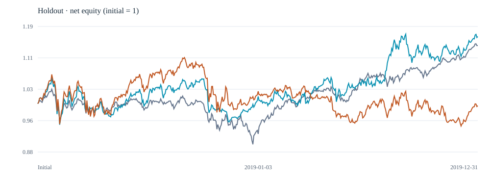
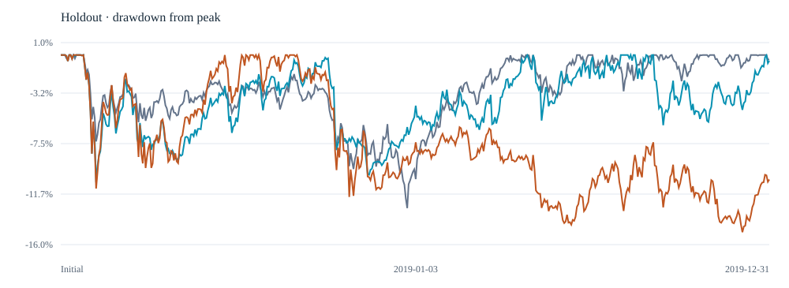
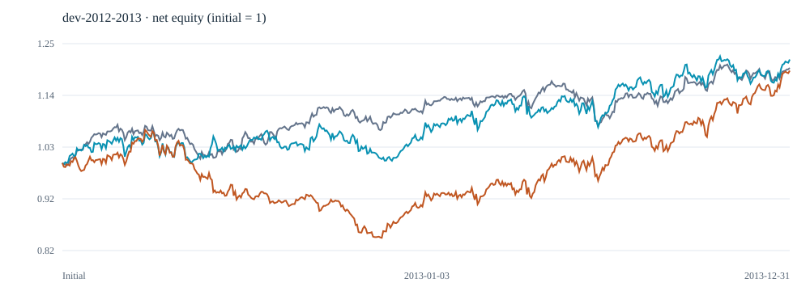
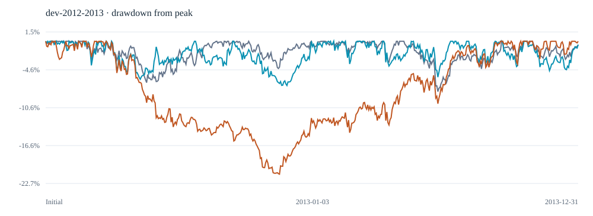
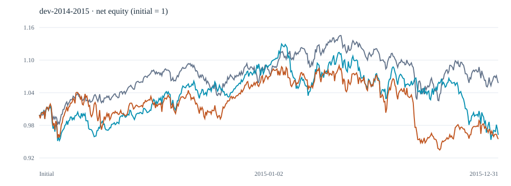
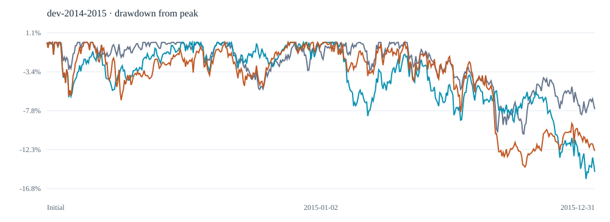
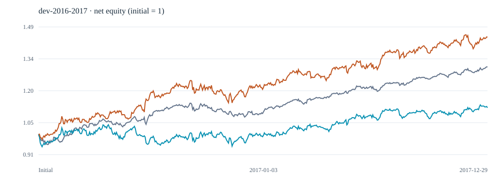
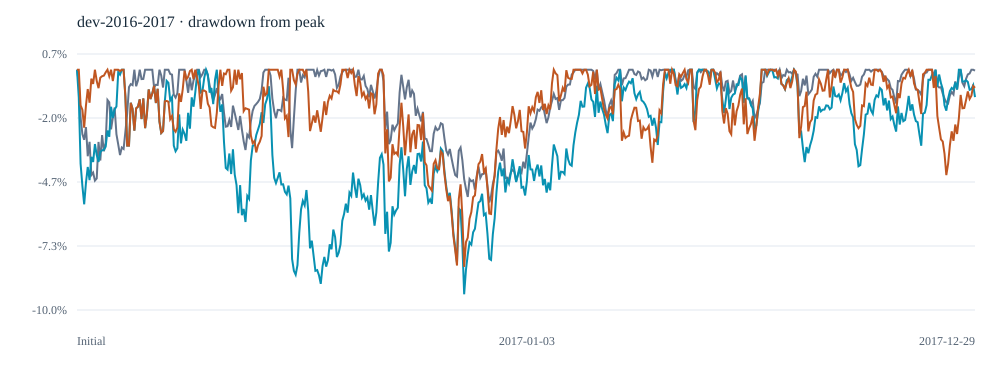

# ETF research case · fixed universe, stated costs

**Qwen NOT RUN. This is a deterministic grid study; its results are not Agent performance.**

Study status: completed.

## 1 · Research question and frozen design

Do simple ETF ranking signals remain competitive with daily equal weighting after stated transaction costs across several development periods?

Fixed universe: EEM, EFA, GLD, IEF, IWM, QQQ, SPY, TLT.

| Window | Start | End | Return observations / role |
| --- | --- | --- | --- |
| Historical context only | 2008-01-02 | 2011-12-30 | No model fitting |
| dev-2012-2013 | 2012-01-04 | 2013-12-31 | 501 |
| dev-2014-2015 | 2014-01-06 | 2015-12-31 | 502 |
| dev-2016-2017 | 2016-01-06 | 2017-12-29 | 501 |
| holdout | 2018-01-04 | 2019-12-31 | 501 |

## 2 · Development selection, including negative results

Selection: momentum-126. Rank by highest worst-window net excess return, then highest mean-window net excess return, then lexicographically smallest candidate ID. Retain every candidate even if all excess returns are negative. Do not retune after the single holdout evaluation. Excess means the difference in total net return versus daily equal weight in the same window, in percentage points; it is not annualized alpha. Negative and rejected outcomes are retained.

| Candidate | dev-2012-2013 | dev-2014-2015 | dev-2016-2017 | Worst excess | Mean excess | Outcome |
| --- | --- | --- | --- | --- | --- | --- |
| momentum-21 | -5.10 pp | -12.57 pp | -14.93 pp | -14.93 pp | -10.87 pp | Rejected by frozen rule; below equal weight in every observed dev window |
| momentum-63 | +1.77 pp | -9.59 pp | -18.48 pp | -18.48 pp | -8.77 pp | Rejected by frozen rule; negative dev window retained |
| momentum-126 | -0.58 pp | -10.37 pp | +13.51 pp | -10.37 pp | +0.86 pp | Selected on development; negative dev window retained |
| reversal-5 | -9.17 pp | -13.53 pp | -16.79 pp | -16.79 pp | -13.16 pp | Rejected by frozen rule; below equal weight in every observed dev window |
| reversal-21 | -14.62 pp | -11.51 pp | +4.49 pp | -14.62 pp | -7.21 pp | Rejected by frozen rule; negative dev window retained |
| low-vol-21 | -8.83 pp | -17.71 pp | -15.64 pp | -17.71 pp | -14.06 pp | Rejected by frozen rule; below equal weight in every observed dev window |
| low-vol-63 | -16.91 pp | -4.27 pp | -16.19 pp | -16.91 pp | -12.46 pp | Rejected by frozen rule; below equal weight in every observed dev window |

## 3 · Holdout comparison

The development-selected candidate (momentum-126) has holdout net excess -14.56 pp versus daily equal weight. This is one historical holdout evaluation, with no retuning after selection.

| Strategy | Net return | Annualized | Sharpe | Max drawdown | Mean daily turnover | Net excess vs EW |
| --- | --- | --- | --- | --- | --- | --- |
| Daily equal weight | 14.06% | 6.84% | 0.77 | 12.90% | 0.71% | +0.00 pp |
| Fixed momentum (fixed\_momentum) | 16.25% | 7.87% | 0.68 | 10.73% | 20.00% | +2.19 pp |
| Selected grid candidate (momentum-126) | -0.49% | -0.25% | 0.05 | 14.92% | 14.22% | -14.56 pp |

## 4 · Development evidence

### dev-2012-2013

| Strategy | Net return | Annualized | Sharpe | Max drawdown | Mean daily turnover | Net excess vs EW |
| --- | --- | --- | --- | --- | --- | --- |
| Daily equal weight | 19.97% | 9.59% | 1.05 | 8.02% | 0.73% | +0.00 pp |
| Fixed momentum (fixed\_momentum) | 21.74% | 10.40% | 0.90 | 7.06% | 18.37% | +1.77 pp |
| Selected grid candidate (momentum-126) | 19.39% | 9.32% | 0.79 | 21.19% | 15.22% | -0.58 pp |

### dev-2014-2015

| Strategy | Net return | Annualized | Sharpe | Max drawdown | Mean daily turnover | Net excess vs EW |
| --- | --- | --- | --- | --- | --- | --- |
| Daily equal weight | 5.90% | 2.92% | 0.38 | 10.52% | 0.75% | +0.00 pp |
| Fixed momentum (fixed\_momentum) | -3.69% | -1.87% | -0.12 | 15.68% | 19.82% | -9.59 pp |
| Selected grid candidate (momentum-126) | -4.47% | -2.27% | -0.15 | 14.30% | 21.66% | -10.37 pp |

### dev-2016-2017

| Strategy | Net return | Annualized | Sharpe | Max drawdown | Mean daily turnover | Net excess vs EW |
| --- | --- | --- | --- | --- | --- | --- |
| Daily equal weight | 30.60% | 14.37% | 1.82 | 5.51% | 0.67% | +0.00 pp |
| Fixed momentum (fixed\_momentum) | 12.11% | 5.92% | 0.55 | 9.31% | 27.62% | -18.48 pp |
| Selected grid candidate (momentum-126) | 44.11% | 20.18% | 1.61 | 8.18% | 11.67% | +13.51 pp |

## 5 · Execution and metric definitions

| Assumption | Value |
| --- | --- |
| Fee (bps per traded notional) | 2.0 |
| Slippage (bps per traded notional) | 3.0 |
| Selected positions | 2 |
| Fixed momentum lookback (sessions) | 63 |

Signals after t close trade at t+1 close and realize returns through t+2 close. Top two are equally weighted daily; the equal-weight benchmark rebalances daily across all eight. Each evaluation window starts from cash and pays entry costs.

Daily net equity compounds the recorded net returns. Drawdown is equity / running peak − 1. Maximum drawdown is reported as a positive loss magnitude. Annualized return and Sharpe use 252 sessions/year; Sharpe uses zero risk-free return and population daily volatility. Turnover is gross traded notional (sum of absolute weight changes); each window starts from cash. Undefined Sharpe remains undefined.

## 6 · Data provenance and evidence

| Field | Declaration |
| --- | --- |
| Source | Kaggle jacksoncrow/stock-market-dataset version 2; uploader states Yahoo Finance via yfinance |
| License | Kaggle uploader declares CC0: Public Domain; upstream Yahoo Finance rights and redistribution permission are not independently verified |
| Price Basis | source Adj Close: split- and dividend-adjusted, as described by uploader; snapshot as of April 2020, not point-in-time corporate-action data |
| Universe Policy | fixed\_demo |
| Data Kind | market |
| Actual Start Date | 2008-01-02 |
| Actual End Date | 2019-12-31 |
| Date Count | 3021 |
| Row Count | 24168 |
| Path Semantics | logical labels; actual locations verified in memory |
| Source snapshot url | https://www.kaggle.com/datasets/jacksoncrow/stock-market-dataset/versions/2 |
| Source snapshot version | 2 |
| Source snapshot last updated | 2020-04-02T10:55:57.307Z |
| Source snapshot retrieved at utc | 2026-11-16T14:33:02.750061+00:00 |
| Source snapshot metadata url | https://www.kaggle.com/api/v1/datasets/view/jacksoncrow/stock-market-dataset |
| Missing dates: method | intersection of observed dates across the fixed universe; no forward/backfill |
| Missing dates: calendar validation | observed source dates only; no independent exchange calendar check |
| Missing dates: discarded date count | 0 |

The report includes the exact study JSON, including daily dates, returns, weights, turnover and net equity. Hashes identify the declared inputs; the renderer does not independently verify the upstream data license or source. Raw market data is not embedded in this report.

[Exact evidence: study.json](study.json)

| Artifact | SHA-256 |
| --- | --- |
| Report evidence (study.json) | dd150d16ecb0a1ef09f98f170466fd22003d53745017fef211a64eddfebd01a7 |
| dataset\_manifest: dataset/manifest.json | 98d13d38635132c42fa0cdfe71058b2c57b8866a7af9cffd777a7cf584056eef |
| dataset\_csv: dataset/prices.csv | 96f74920d5ba91890451599d16240a548bbc9aa186c73136818dff205d2f7444 |
| protocol: config/etf\_case\_study.json | ee50dd2e5058dd930412c92f6abf8cc723fa0317d1dfa2d132a3bb20d9dd7106 |
| quant\_research/etf\_study.py | a577f46d489909cb20d3b6a8d79711f4e6a05567292322934446484986e6a4c9 |
| quant\_research/backtest.py | 0c730d918bf1db2d88f16178739fe73f701764e8de00cbf01201be16d55bec73 |
| quant\_research/data.py | a176b12d1c09e5c5cf887c51177f597658c7cfcbc2078aa19f78bc68d846a86c |
| quant\_research/signals.py | 683b5b6affcdfc7fd41b4c230aac8aa719b4442d771abaa5cf79ae66f1c35015 |
| research\_agent/io.py | 69a34f9aec743d54574d51a15fffae24fd6ea8f06efa7920c0da395d71f49004 |
| Source metadata | 956ccfe261785155db0a8a6913335ce822ce20b6250cdee881a0d2b056902dfa |
| Source etfs/SPY.csv | 7e904487406dfed06b87da8902f5387f1ea5a8d9ced8246c29a9e7e04f2459df |
| Source etfs/QQQ.csv | 7f2d37ca67be31e40b58894406addd85ffd9b58bbb4cf6a72243ef511e4aec84 |
| Source etfs/IWM.csv | a9ed6dbb096c62a7c6e65f58b13b09fe17a0ac493d1abf7dbdf38551621bca05 |
| Source etfs/EFA.csv | 2d6d3aed6d88801d92866396c3231f26d0c13faa758a650ad0256d6b3a56ebd9 |
| Source etfs/EEM.csv | 9b36d40bdd924ff612540a32cc26de935ab964e1092374718c99be8185c83c23 |
| Source etfs/TLT.csv | b48901861b05962ebc61d50871c3dad2bf5ebcec89ef056478a51ff20d2fa5a6 |
| Source etfs/IEF.csv | fb1935f038495d9c05224882b52cc66b419d7b1ff78f91e01651c84a6cb866e0 |
| Source etfs/GLD.csv | 6d7593eb533c73dda019b64053453664cfd1dc468613b0716effc6a32264ba9f |
| Frozen dev selection | 6b906f71c7ac0067b5cc4c87b009dd57d49ab8ad2c7a829f0dc5f8943b3d0e93 |

## 7 · Limits and model usage

**Qwen NOT RUN. This is a deterministic grid study; its results are not Agent performance.**

| Recorded model usage | Value |
| --- | --- |
| model\_calls | 0 |
| input\_tokens | 0 |
| output\_tokens | 0 |
| total\_tokens | 0 |

- Eight named, long-lived ETFs chosen by asset category, not observed backtest performance. Fixed research universe does not establish point-in-time membership or freedom from survivorship bias.
- A fixed universe of surviving ETFs does not establish point-in-time universe membership or remove survivorship bias.
- Close-price data and the declared price basis may omit distributions or contain vendor adjustments; inspect the dataset manifest.
- Daily-close execution with fixed fees and slippage is a research assumption, not evidence of achievable fills or capacity.
- The grid was selected on development data; a single historical holdout is descriptive evidence, not statistical proof or investment advice.
- The exclusive holdout marker applies only to this output directory; copies and previously viewed data cannot be made unseen.
- No model or Agent comparison was run. A later comparison needs a newly frozen protocol and an unopened final interval.
- Fixed, retrospectively selected surviving ETF universe; not survivorship-bias-free.
- Adjusted close is a later snapshot and is not point-in-time corporate-action data.
- Source adjustments and completeness are declared by the uploader, not independently reconstructed.
- Keep raw and normalized market data local; uploader license does not establish upstream rights.
- A Qwen comparison has not been established by this deterministic report. A future Agent study needs its own frozen protocol and an unopened final interval.
